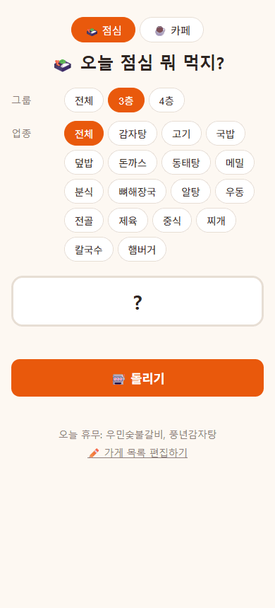
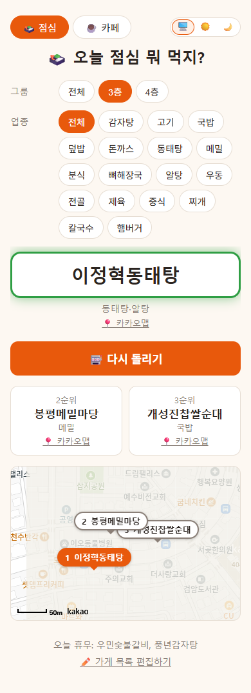
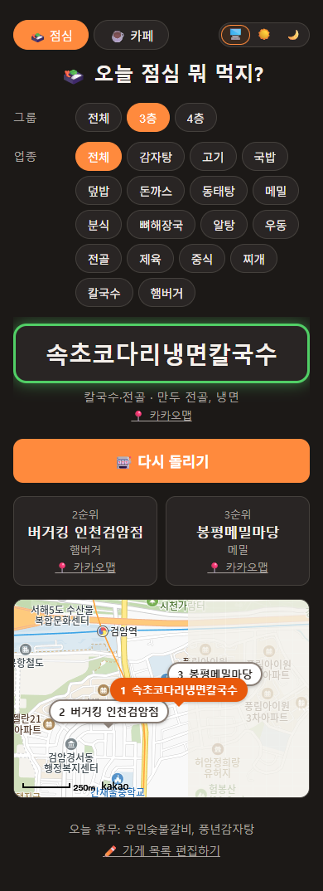
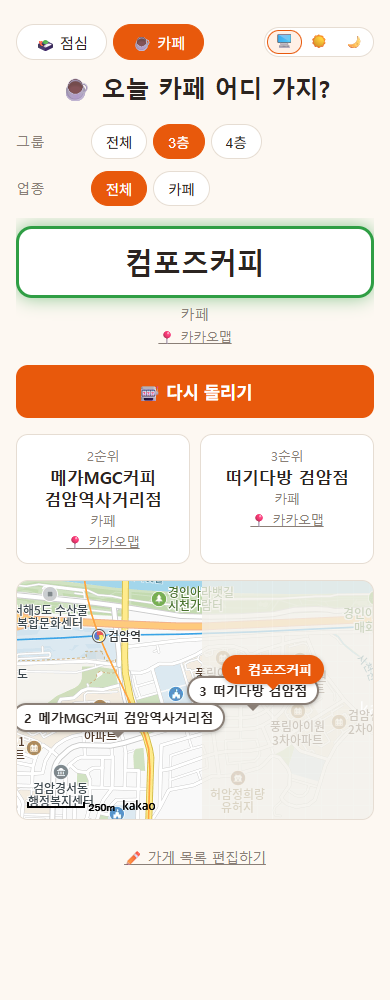
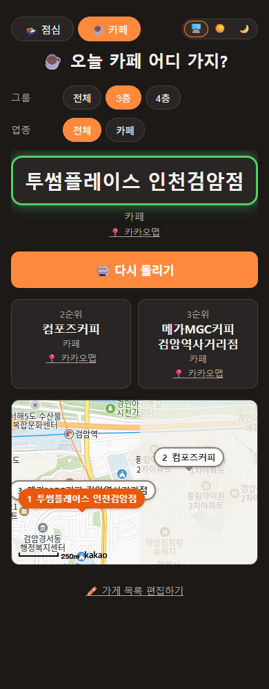
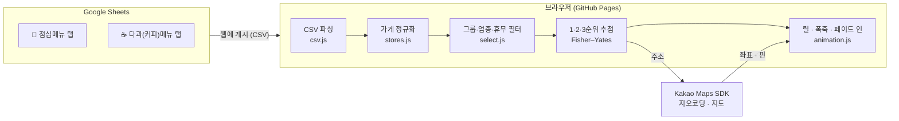

<div align="center">

# 🍱 오늘 점심 뭐 먹지?

**"아무거나"가 제일 어려운 사람들을 위한 점심·카페 룰렛**

오늘 쉬는 가게는 알아서 빼고, 1·2·3순위를 뽑아 지도에 보여드려요.

[](https://colossuscms.github.io/lunch-selector/)




</div>

---

## 💭 왜 만들었나요

매일 12시, 같은 대화가 반복됐어요.

> "뭐 먹지?" — "아무거나." — "거기 오늘 쉬는 날 아냐?" — "…그럼 어디 가?"

회사 근처에서 갈 만한 가게는 정해져 있는데, **가게마다 쉬는 요일이 다르고**, 층마다 **같이 다니는 점심 그룹이 가는 곳도 조금씩 달랐어요.** 고르는 데 쓰는 에너지를 없애고 싶어서, 정해진 목록에서 오늘 문 연 곳만 골라 대신 정해주는 사이트를 만들었습니다.

그리고 한 가지 더. 막상 뽑힌 곳이 내키지 않거나 갑자기 문을 닫았을 때 다시 돌리는 건 번거롭죠. 그래서 처음부터 **2순위·3순위까지** 함께 뽑아요.

## ✨ 주요 기능

| | |
|---|---|
| 🎰 **슬롯 룰렛 연출** | 이름이 점점 느려지며 멈추고, 1순위에 폭죽이 터진 뒤 2·3순위가 차례로 나타나요. |
| 📅 **정기휴무 자동 제외** | 시트에 `월`, `토,일`, `토요일 일요일`처럼 편하게 적어두면 오늘 쉬는 곳은 후보에서 빠지고 화면 아래에 따로 알려줘요. |
| 👥 **그룹 · 업종 필터** | 3층/4층처럼 그룹을 고르거나 [전체]로 볼 수 있고, 업종은 여러 개 골라 OR로 걸러요. 한 가게가 여러 그룹·업종에 속할 수 있어요. |
| 🗺️ **지도에 1·2·3순위 표시** | 주소를 좌표로 바꿔 순위 핀을 찍고, 세 곳이 한 화면에 들어오게 맞춰요. 카드마다 카카오맵 바로가기가 있어 휴대폰에서 바로 길찾기로 이어져요. |
| ☕ **점심 ↔ 카페 전환** | 같은 양식의 시트 탭만 하나 더 만들면, 버튼 하나로 "오늘 카페 어디 가지?"가 돼요. |
| ✏️ **누구나 고치는 목록** | 가게 목록은 구글 시트예요. 개발자가 아니어도 시트만 고치면 새로고침 한 번으로 반영돼요. |
| 🌗 **테마 · 접근성** | 오른쪽 위에서 🖥️ 시스템 · ☀️ 라이트 · 🌙 다크를 고를 수 있고, 고른 테마는 기억해요. 움직임 줄이기 설정을 존중하고, 화면 낭독기에는 회전 중 이름이 아닌 최종 결과만 읽어줘요. |

## 📸 화면

<table>
  <tr>
    <th>점심 · 라이트</th>
    <th>점심 · 다크</th>
    <th>카페 · 라이트</th>
    <th>카페 · 다크</th>
  </tr>
  <tr>
    <td></td>
    <td></td>
    <td></td>
    <td></td>
  </tr>
</table>

## ⚙️ 어떻게 동작하나요

서버가 하나도 없어요. 정적 파일은 GitHub Pages가, 데이터는 구글 시트가, 지도는 카카오가 맡고 나머지는 전부 브라우저에서 일어나요.



## 🧠 고민했던 것들

<details>
<summary><b>DB 없이 "누구나 고칠 수 있는" 데이터를 어디에 둘까?</b></summary>

처음엔 JSON 파일을 생각했지만, 그러면 가게 하나 추가할 때마다 코드를 고치고 배포해야 해요. 동료들이 직접 고칠 수 있어야 해서 **구글 시트를 DB로** 쓰기로 했어요.

- 처음엔 gviz 엔드포인트로 읽었는데, 그러려면 시트를 "링크가 있는 모든 사용자"에게 열어야 했어요.
- 그래서 **"웹에 게시" CSV**로 바꿨어요. 시트 공유 범위는 좁게 유지하면서 사이트는 읽기 전용 CSV만 받아요. 대신 반영까지 최대 5분 지연이 생기는데, 점심 목록에는 충분히 괜찮은 트레이드오프였어요.
- 게시 범위를 "전체 문서"로 두고 탭 번호(`gid`)만 바꿔 읽게 해서, 탭 하나 추가로 카페 모드가 생겨요.

</details>

<details>
<summary><b>사람이 적는 데이터는 늘 제멋대로다</b></summary>

시트를 여러 사람이 고치다 보니 표기가 제각각이었어요. 파싱을 엄격하게 하는 대신 **관대하게** 받아들이도록 했어요.

- 휴무: `토,일` · `토 일` · `토일` · `토/일` · `토요일, 일요일`이 모두 같은 뜻이에요. 모르는 값은 무시하고 콘솔에 경고만 남겨요.
- 다중 값: 반각·전각 쉼표 모두 허용, 공백·중복 제거.
- 헤더: 열 순서 무관, BOM·앞뒤 공백 무시, 모르는 열은 건너뛰기.
- 주소: `승학로 508 1-2층 104~105,201호`처럼 층·호수가 붙어 지오코딩이 실패하면, **건물 번호까지 잘라 한 번 더** 찾아요.

</details>

<details>
<summary><b>"갑자기 문 닫음"은 데이터로 막을 수 없다</b></summary>

정기휴무는 데이터로 거를 수 있지만, 임시 휴무·연휴·사장님 휴가는 예측할 수 없어요. 이걸 시스템으로 해결하려 하지 않고 **2·3순위를 함께 보여주는 UX**로 풀었어요. 다시 돌리지 않고 바로 다음 후보로 가면 되니까요.

</details>

<details>
<summary><b>재미있되, 거슬리지 않게</b></summary>

- 릴은 `requestAnimationFrame`으로 돌리고, 이름이 바뀌는 간격을 `40 + 260·p²`ms로 늘려 자연스럽게 감속해요.
- 폭죽은 결과 영역이 아니라 **페이지 전체**에 뿌리고, 클릭을 막지 않게 `pointer-events: none`.
- `prefers-reduced-motion`이면 연출 없이 결과만 바로 보여줘요.
- 지도 주소 조회는 릴이 도는 2초 동안 **미리 시작**해서, 결과가 나올 즈음 지도도 거의 준비돼 있어요. 늦게 끝난 조회가 다음 결과 화면을 덮지 않도록 회차 번호로 막아요.
- 키가 없거나, 지도 SDK가 막히거나, 주소를 못 찾아도 **지도만 조용히 숨고** 추천은 그대로 동작해요.

</details>

## 🛠️ 기술 스택

| 영역 | 사용한 것 |
|---|---|
| 화면 | HTML · CSS (커스텀 프로퍼티로 라이트/다크 토큰) · Vanilla JS ES Modules |
| 데이터 | Google Sheets "웹에 게시" CSV, 직접 작성한 RFC 4180 CSV 파서 |
| 지도 | Kakao Maps JavaScript SDK (지도 · 주소 검색) |
| 테스트 | Node 내장 테스트 러너 `node:test` (외부 의존성 0) |
| 배포 | GitHub Pages (빌드 단계 없음) |

## 📁 구조

```
lunch-selector/
├─ index.html          # 한 페이지가 전부
├─ css/style.css       # 테마 토큰, 칩, 릴, 폭죽, 지도 핀
├─ js/
│  ├─ config.js        # 시트 주소 · 모드(탭) · 카카오 키
│  ├─ csv.js           # CSV 파서
│  ├─ stores.js        # 행 → 가게 정규화 (휴무·다중 값 파싱)
│  ├─ data.js          # 불러오기
│  ├─ select.js        # 그룹·업종·휴무 필터, 추첨
│  ├─ animation.js     # 릴 · 폭죽 · 순차 페이드 인
│  ├─ map.js           # 지오코딩 캐시 · 지도 핀 · 카카오맵 링크
│  ├─ theme.js         # 시스템 · 라이트 · 다크 테마
│  └─ app.js           # 화면 상태와 이벤트
├─ tests/              # node:test 단위 테스트 59개
└─ docs/SETUP.md       # 설치·운영 가이드
```

화면과 상관없는 로직(파싱 · 필터 · 추첨 · 주소 정리)은 DOM 없이 순수 함수로 나눠서 Node에서 바로 테스트해요.

```bash
npm test   # Node 22+
```

## 🚀 직접 써보기

시트를 만들고 연결하는 방법, 카카오 키 발급, 로컬 실행, GitHub Pages 배포는 **[설치·운영 가이드](docs/SETUP.md)**에 정리해 뒀어요.

<div align="center">
<br>

**오늘 점심은 정하셨나요? → [🎰 돌리러 가기](https://colossuscms.github.io/lunch-selector/)**

</div>
