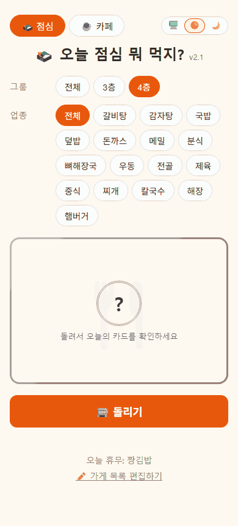
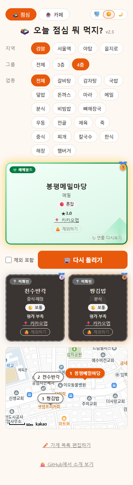
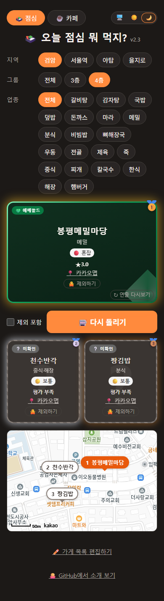
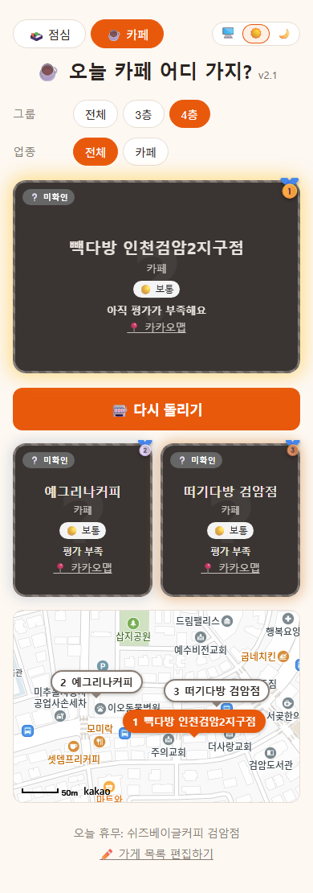
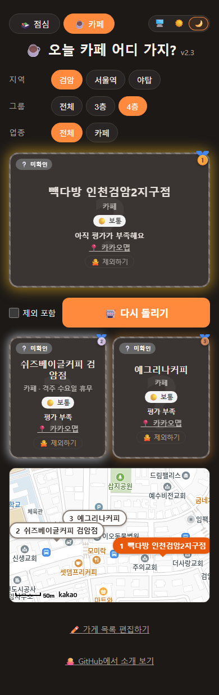
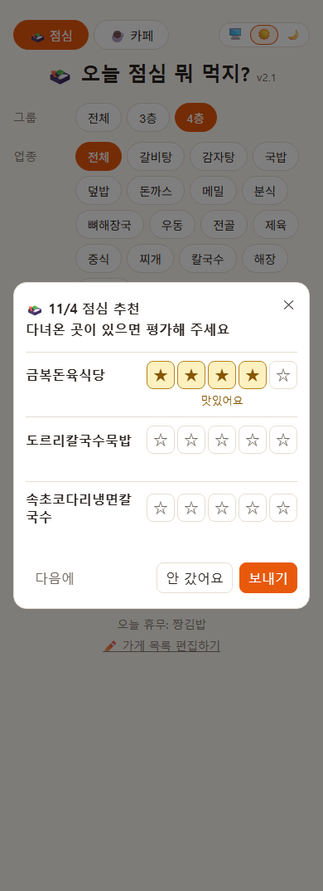
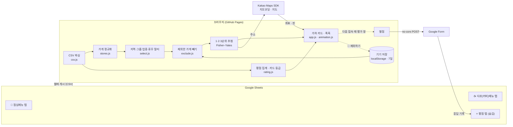

<div align="center">

# 🍱 오늘 점심 뭐 먹지?

**"아무거나"가 제일 어려운 사람들을 위한 점심·카페 룰렛**

오늘 쉬는 가게는 알아서 빼고, 1·2·3순위를 **가챠 카드**로 뽑아 지도에 보여드려요.<br>
다녀온 곳에 남긴 동료들의 별점이 카드 등급이 돼요.

[](https://colossuscms.github.io/lunch-selector/)




</div>

---

## 💭 왜 만들었나요

매일 12시, 같은 대화가 반복됐어요.

> "뭐 먹지?" — "아무거나." — "거기 오늘 쉬는 날 아냐?" — "…그럼 어디 가?"

회사 근처에서 갈 만한 가게는 정해져 있는데, **가게마다 쉬는 요일이 다르고**, 층마다 **같이 다니는 점심 그룹이 가는 곳도 조금씩 달랐어요.** 고르는 데 쓰는 에너지를 없애고 싶어서, 정해진 목록에서 오늘 문 연 곳만 골라 대신 정해주는 사이트를 만들었습니다.

그리고 한 가지 더. 막상 뽑힌 곳이 내키지 않거나 갑자기 문을 닫았을 때 다시 돌리는 건 번거롭죠. 그래서 처음부터 **2순위·3순위까지** 함께 뽑아요.

## ✨ 주요 기능

| | |
|---|---|
| 🃏 **가챠 카드 연출** | 카드 안에서 이름이 세로로 흐르며 돌아요. 원석·미확인은 룰렛이 흐려진 뒤 물음표를 거쳐 결과 카드로, 상위 등급은 룰렛이 사라질 때 전체 화면의 업종·등급 단서와 빛으로 이어져요. 합성 효과음이 함께 나고, 연출 창을 누르면 최종 공개로 건너뛰어요. 한 번 더 누르거나 공개 후 5초가 지나면 결과 화면으로 돌아와요. 상위 등급의 1순위 카드에서 `↻ 연출 다시보기`를 누르면 같은 결과의 연출을 창 안 룰렛부터 다시 볼 수 있어요. 움직임 줄이기 설정에서는 연출·소리·다시보기를 생략해요. 순위는 🥇🥈🥉 메달과 카드 외곽의 금·은·동 빛으로 표시돼요. |
| 💎 **별점으로 정해지는 카드 등급** | 동료들의 평균 별점에 따라 카드가 `🪨 원석 → 💚 에메랄드 → ❤️ 루비 → 💎 다이아`로 화려해져요. 평가가 2건 미만이면 `❔ 미확인` 카드로 나와요. 1순위가 다이아면 빛이 터져요. |
| ⭐ **별점** | 추천받고 30분쯤 지나 다시 들어오면 "다녀온 곳이 있으면 평가해 주세요" 창이 떠요. 별점은 익명으로 모여 카드에 `★4.2`처럼 보여요. |
| 🙅 **다녀온 가게 일주일 제외** | 결과 카드에서 제외하면 이 기기의 룰렛에서 7일 동안 빠져요. 조건에 맞는 가게가 모두 제외돼 있으면 안내와 함께 그 후보 전체에서 뽑아요. `제외 포함`을 체크하면 제외 기록을 유지한 채 제외한 가게도 넣고 돌릴 수 있어요. |
| 🚦 **혼잡도 표시** | 모든 결과 카드에 여유·보통·혼잡을 표시해 다음 후보로 갈지 판단할 수 있어요. 추첨 확률에는 영향을 주지 않아요. |
| 📅 **정기휴무 자동 제외** | 시트에 `월`, `토,일`, `토요일 일요일`처럼 편하게 적어두면 오늘 쉬는 곳은 후보에서 빠지고 화면 아래에 따로 알려줘요. |
| 👥 **지역 · 그룹 · 업종 필터** | 먼저 지역을 고르고 3층/4층처럼 그룹을 고르거나 [전체]로 볼 수 있고, 업종은 여러 개 골라 OR로 걸러요. 한 가게가 여러 그룹·업종에 속할 수 있어요. |
| 🗺️ **지도에 1·2·3순위 표시** | 주소를 좌표로 바꿔 순위 핀을 찍고, 세 곳이 한 화면에 들어오게 맞춰요. 카드마다 카카오맵 바로가기가 있어 휴대폰에서 바로 길찾기로 이어져요. |
| ☕ **점심 ↔ 카페 전환** | 같은 양식의 시트 탭만 하나 더 만들면, 버튼 하나로 "오늘 카페 어디 가지?"가 돼요. |
| ✏️ **누구나 고치는 목록** | 가게 목록은 구글 시트예요. 개발자가 아니어도 시트만 고치면 몇 분 안에 반영돼요. |
| 🌗 **테마 · 접근성** | 오른쪽 위에서 🖥️ 시스템 · ☀️ 라이트 · 🌙 다크를 고를 수 있고, 고른 테마는 기억해요. 움직임 줄이기 설정을 존중하고, 화면 낭독기에는 회전 중 이름이 아닌 최종 결과만 읽어줘요. |

## 📸 화면

<table>
  <tr>
    <th>점심 · 라이트</th>
    <th>점심 · 다크</th>
    <th>카페 · 라이트</th>
    <th>카페 · 다크</th>
  </tr>
  <tr>
    <td></td>
    <td></td>
    <td></td>
    <td></td>
  </tr>
</table>

다녀온 가게는 이름 옆 별점으로 평가해요.



## ⚙️ 어떻게 동작하나요

서버가 하나도 없어요. 정적 파일은 GitHub Pages가, 데이터는 구글 시트가, 지도는 카카오가 맡고 나머지는 전부 브라우저에서 일어나요.



## 🧠 고민했던 것들

<details>
<summary><b>다녀온 가게를 백엔드 없이 빼려면</b></summary>

"지난주에 간 데가 또 나왔어요"라는 의견을 받았어요. 서버가 있으면 방문 기록을 모으면 되지만, 이 사이트에는 서버도 로그인도 없어요.

- 보통 **한 사람이 돌려서 팀에 공유**하니까, 돌리는 사람의 기기에만 기록이 있어도 충분했어요. 그래서 기록은 **브라우저 저장소(localStorage)** 에 두고, 기기 사이 동기화는 하지 않아요.
- 실제로 갔는지 확인할 방법은 없어요. 목표를 "확실히 빼기"가 아니라 **"최근 간 곳이 웬만하면 안 나오기"** 로 잡고 사용자 입력을 믿기로 했어요.
- 평가 창에 묶는 방법도 생각했지만, 어디 갈지는 결과를 본 순간 정해지고 평가는 30분 뒤에야 물어봐요. 그래서 **결과 카드에서 바로** 고르게 했어요. "오늘은 여기 말고"로 오해하지 않도록 누르면 "일주일 동안 룰렛에 나타나지 않아요"라고 한 번 더 확인해요.
- 기간은 2주를 제안받았지만 **1주로 시작**해서 실제로 써 보며 조정하기로 했어요. 조건에 맞는 가게가 모두 제외돼 있으면 룰렛이 멈추지 않도록 제외를 무시하고 뽑아요.
- 되돌리기나 제외 목록 화면은 설정 화면이 없는 지금 구성에는 과하다고 보고 넣지 않았어요. 일주일이 지나면 저절로 돌아와요.

</details>

<details>
<summary><b>지역이 늘어도 코드를 고치지 않으려면</b></summary>

검암에서 쓰던 목록에 다른 지역도 담고 싶어졌어요. 지역마다 시트 탭을 만들면 새 지역을 추가할 때마다 코드에 `gid`를 설정해야 해서, 기존 점심·카페 탭 안에 **`지역` 열**을 두기로 했어요.

- 서로 다른 지역의 가게를 섞어 뽑을 일은 없어 지역에는 **[전체] 없이 하나만** 고르게 했어요. 그룹은 그 지역 안에서 필요할 때 고르는 단계예요.
- 지역을 오갈 때마다 그룹을 다시 고르지 않도록 **지역별 마지막 그룹**을 기억해요. 지역이 하나면 지역 줄을 숨겨 기존처럼 바로 쓸 수 있어요.
- 이름이 같은 체인점의 평가가 섞이지 않게 평점 키도 **모드 + 지역 + 가게명**으로 나눴어요.

</details>

<details>
<summary><b>혼잡도는 '확률'이 아니라 '정보'로</b></summary>

늘 붐비는 가게라면 자리가 없을 수도 있어요. 그렇다고 혼잡한 곳이 덜 뽑히게 만들면, 목록의 가게를 같은 확률로 뽑는 원칙과 부딪히고 결과를 예상하기도 어려워져요.

그래서 혼잡도는 **카드에 표시만** 하기로 했어요. 오늘은 기다릴지, 함께 나온 2순위로 갈지는 사람이 판단하면 돼요.

</details>

<details>
<summary><b>좋아요를 뺀 이유</b></summary>

처음에는 별점과 좋아요를 함께 받았어요. 실제 응답을 보니 **좋아요만 누른 경우는 없고 늘 별점과 함께** 와서, 별점에 더해 알 수 있는 정보가 없었어요.

평가 창을 **별점 하나로 단순화**하고, 여러 가게를 차례로 평가하기 편하게 이름은 왼쪽, 별은 오른쪽에 놓았어요. 기존 폼 질문과 응답은 남겨 둬도 앱에서 보내거나 집계하지 않아요.

</details>

<details>
<summary><b>DB 없이 "누구나 고칠 수 있는" 데이터를 어디에 둘까?</b></summary>

처음엔 JSON 파일을 생각했지만, 그러면 가게 하나 추가할 때마다 코드를 고치고 배포해야 해요. 동료들이 직접 고칠 수 있어야 해서 **구글 시트를 DB로** 쓰기로 했어요.

- 처음엔 gviz 엔드포인트로 읽었는데, 그러려면 시트를 "링크가 있는 모든 사용자"에게 열어야 했어요.
- 그래서 **"웹에 게시" CSV**로 바꿨어요. 시트 공유 범위는 좁게 유지하면서 사이트는 읽기 전용 CSV만 받아요. 대신 반영까지 최대 5분 지연이 생기는데, 점심 목록에는 충분히 괜찮은 트레이드오프였어요.
- 게시 범위를 "전체 문서"로 두고 탭 번호(`gid`)만 바꿔 읽게 해서, 탭 하나 추가로 카페 모드가 생겨요.

</details>

<details>
<summary><b>사람이 적는 데이터는 늘 제멋대로다</b></summary>

시트를 여러 사람이 고치다 보니 표기가 제각각이었어요. 파싱을 엄격하게 하는 대신 **관대하게** 받아들이도록 했어요.

- 휴무: `토,일` · `토 일` · `토일` · `토/일` · `토요일, 일요일`이 모두 같은 뜻이에요. 모르는 값은 무시하고 콘솔에 경고만 남겨요.
- 다중 값: 반각·전각 쉼표 모두 허용, 공백·중복 제거.
- 헤더: 열 순서 무관, BOM·앞뒤 공백 무시, 모르는 열은 건너뛰기.
- 주소: `승학로 508 1-2층 104~105,201호`처럼 층·호수가 붙어 지오코딩이 실패하면, **건물 번호까지 잘라 한 번 더** 찾아요.

</details>

<details>
<summary><b>"갑자기 문 닫음"은 데이터로 막을 수 없다</b></summary>

정기휴무는 데이터로 거를 수 있지만, 임시 휴무·연휴·사장님 휴가는 예측할 수 없어요. 이걸 시스템으로 해결하려 하지 않고 **2·3순위를 함께 보여주는 UX**로 풀었어요. 다시 돌리지 않고 바로 다음 후보로 가면 되니까요.

</details>

<details>
<summary><b>백엔드 없이 동료들의 평가를 모으려면?</b></summary>

정적 사이트는 시트에 직접 쓸 수 없어요. 그렇다고 평가 하나 때문에 서버를 두고 싶지는 않았어요.

- 쓰기는 **구글 폼**에 맡겼어요. 앱이 폼 전송 주소로 `no-cors` POST를 보내면 응답이 시트의 `평점` 탭에 쌓이고, 읽기는 가게 목록과 똑같이 게시 CSV로 해요. 응답 탭은 숨겨 둬도 게시 CSV로 읽혀요.
- 대신 `no-cors`라 전송 성공 여부를 확실히 알 수 없어요. 네트워크 오류만 잡고, 익명 별점이라 그 정도면 충분하다고 봤어요.
- 뽑는 순간엔 아직 먹어보지 않았으니 평가가 의미 없어요. 마지막 추천을 기기에 기억해 두었다가 **30분이 지난 뒤 다시 들어왔을 때**, 달력 기준 3일 이내의 추천만 물어봐요.
- 로그인이 없으니 중복은 "한 번 답한 추천은 다시 묻지 않는다"로 막아요. 여러 곳을 보내다 일부만 실패하면 실패한 가게만 다음에 다시 물어요.
- 설정 값이 하나라도 비어 있으면 평가 기능 전체가 조용히 꺼져요. 폼을 만들기 전에 배포해도 안전해요.

</details>

<details>
<summary><b>가챠 카드: 순위는 '무대', 평점은 '등급'</b></summary>

가챠의 재미는 "이번엔 뭐가 나올까"라는 변동에서 나와요. 그런데 순위는 매번 1·2·3으로 정해져 있어서, 순위만으로 연출을 나누면 금방 익숙해져요. 반대로 평점만 쓰면 1순위가 평범한 등급일 때 1순위다운 무게감이 사라져요.

- 그래서 두 축으로 나눴어요. **순위**는 카드 크기·등장 순서·뒤집기·메달·외곽 빛을, **평점 등급**은 카드 테두리·바탕·반짝임을 정해요. "3순위에서 다이아가 나오는" 순간이 생기면서도 1순위는 늘 마지막에 가장 크게 뒤집혀요.
- 등급 이름은 순위의 금·은·동과 겹치지 않도록 **보석**으로, 기준은 범위가 정해진 평균 별점으로 했어요.
- 평가 한두 건으로 최고 등급이 되지 않게 2건 미만은 `미확인`으로 둬요. 평가가 별로 없는 지금은 오히려 "아직 아무도 모르는 가게" 카드가 평가를 남기고 싶게 만들어요.
- 사진이 없어서 CSS 그라데이션·그림자·애니메이션만으로 등급 차이를 만들었어요.

</details>

<details>
<summary><b>재미있되, 거슬리지 않게</b></summary>

- 릴은 `requestAnimationFrame`으로 돌리고, 이름이 바뀌는 간격을 `40 + 260·p²`ms로 늘려 자연스럽게 감속해요. 1순위 카드 뒷면 크기를 처음부터 고정해 두어서, 돌리는 동안 화면이 출렁이지 않아요.
- 폭죽은 결과 영역이 아니라 **페이지 전체**에 뿌리고, 클릭을 막지 않게 `pointer-events: none`.
- `prefers-reduced-motion`이면 연출 없이 결과만 바로 보여줘요.
- 지도 주소 조회는 릴이 도는 2초 동안 **미리 시작**해서, 결과가 나올 즈음 지도도 거의 준비돼 있어요. 늦게 끝난 조회가 다음 결과 화면을 덮지 않도록 회차 번호로 막아요.
- 키가 없거나, 지도 SDK가 막히거나, 주소를 못 찾아도 **지도만 조용히 숨고** 추천은 그대로 동작해요.

</details>

## 🛠️ 기술 스택

| 영역 | 사용한 것 |
|---|---|
| 화면 | HTML · CSS (커스텀 프로퍼티로 라이트/다크 토큰) · Vanilla JS ES Modules |
| 데이터 | Google Sheets "웹에 게시" CSV, 직접 작성한 RFC 4180 CSV 파서, 평가 기록은 Google Forms |
| 지도 | Kakao Maps JavaScript SDK (지도 · 주소 검색) |
| 테스트 | Node 내장 테스트 러너 `node:test` (외부 의존성 0) |
| 배포 | GitHub Pages (빌드 단계 없음) |

## 📁 구조

```
lunch-selector/
├─ index.html          # 한 페이지가 전부
├─ css/style.css       # 테마 토큰, 칩, 가챠 카드·등급, 평가 창, 폭죽, 지도 핀
├─ js/
│  ├─ config.js        # 시트 주소 · 모드(탭) · 카카오 키 · 평가 폼 설정
│  ├─ csv.js           # CSV 파서
│  ├─ stores.js        # 행 → 가게 정규화 (휴무·다중 값 파싱)
│  ├─ data.js          # 불러오기 (10초 제한 시간, 최신 요청만 반영)
│  ├─ select.js        # 지역·그룹·업종·휴무 필터, 추첨
│  ├─ rating.js        # 평점 집계 · 카드 등급 · 평가 시점 판정
│  ├─ exclude.js       # 기기별 제외 기록 만료 · 후보 제외 · 전부 제외 시 대체
│  ├─ animation.js     # 카드 안 세로 룰렛 · 폭죽 · 순차 페이드 인
│  ├─ reveal.js        # 카드 안 룰렛 · 상위 등급 전체 화면 공개 연출
│  ├─ reveal-plan.js   # 등급별 흐름 · 색 · 1.0배속 시간
│  ├─ sound.js         # Web Audio 합성 효과음 · 재생/정지
│  ├─ map.js           # 지오코딩 캐시 · 지도 핀 · 카카오맵 링크
│  ├─ theme.js         # 시스템 · 라이트 · 다크 테마
│  └─ app.js           # 화면 상태와 이벤트
├─ tests/              # node:test 단위 테스트 103개
└─ docs/SETUP.md       # 설치·운영 가이드
```

화면과 상관없는 로직(파싱 · 필터 · 추첨 · 주소 정리 · 평점 집계 · 등급 판정)은 DOM 없이 순수 함수로 나눠서 Node에서 바로 테스트해요.

```bash
npm test   # Node 22+
```

## 🚀 직접 써보기

시트를 만들고 연결하는 방법, 카카오 키 발급, 별점(구글 폼) 켜기, 로컬 실행, GitHub Pages 배포는 **[설치·운영 가이드](docs/SETUP.md)**에 정리해 뒀어요.

<div align="center">
<br>

**오늘 점심은 정하셨나요? → [🎰 돌리러 가기](https://colossuscms.github.io/lunch-selector/)**

</div>
